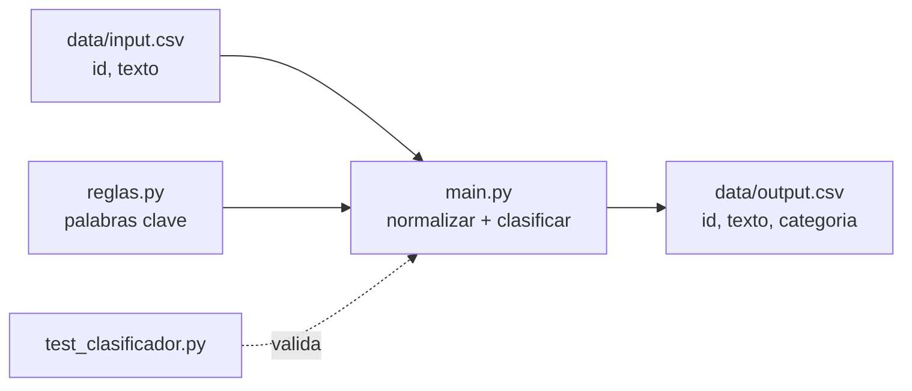

# clasificador-textos

[](https://github.com/USUARIO/REPO/actions/workflows/ci.yml)
[](https://codecov.io/gh/USUARIO/REPO)

Plataforma de datos para tickets de soporte que crece versión a versión: hoy es un script que
clasifica tickets por palabras clave.

## Problema de negocio

1. El equipo de soporte recibe tickets sin clasificar y los reparte a mano entre los equipos.
2. Eso retrasa la primera respuesta y no deja medir cuántos tickets llegan de cada tipo.
3. Objetivo: asignar cada ticket a `facturacion`, `tecnico`, `cuenta` u `otro` de forma automática y auditable.

## Arquitectura

**Estado actual (v0.1)**



## Cómo correrlo en local

Requiere Python 3.11+.

```bash
pip install -r requirements.txt && python main.py
```

Genera `data/output.csv`. Tests con cobertura:

```bash
python -m pytest -q --cov
```

## Decisiones clave

| ADR | Decisión |
|---|---|
| [0001](docs/adr/0001-registrar-decisiones-con-adr.md) | Registrar las decisiones de arquitectura como ADR |
| [0002](docs/adr/0002-clasificacion-por-palabras-clave.md) | Clasificar por palabras clave antes que con ML o LLM |
| [0003](docs/adr/0003-solo-libreria-estandar.md) | Usar solo la librería estándar de Python en el núcleo |

Índice completo y plantilla en [docs/adr](docs/adr/README.md).

## Trabajo con agentes y validación

El código se escribe junto con Claude Code. Para que el agente sea útil y su código confiable:

- **Contexto explícito**: [`CLAUDE.md`](CLAUDE.md) fija categorías, reglas para casos ambiguos
  (con el número de ticket que las motivó), restricciones técnicas y la regla de que los tests
  deben pasar antes de cerrar una tarea.
- **Tests como contrato**: `test_clasificador.py` cubre normalización (mayúsculas, tildes),
  cada categoría, el caso sin coincidencias y la lectura/escritura del CSV. El agente no da una
  tarea por terminada si `python -m pytest -q` falla.
- **Segunda opinión independiente**: la skill [`comparar-clasificacion`](.claude/skills/comparar-clasificacion/SKILL.md)
  hace que el agente clasifique los tickets con criterio propio (`data/output_ia.csv`), compare
  con el script y solo *sugiera* cambios en `reglas.py`; no los aplica sin aprobación.
  Resultado actual: **20/20 tickets coinciden**.
- **Revisión humana**: todo cambio se lee antes de hacer commit; las decisiones no triviales
  quedan como ADR.

## Versiones

| Versión | Tema | Estado |
|---|---|---|
| v0.1 | Trabajo agéntico y arranque del repo | ✅ |

Detalle de cada versión en [CHANGELOG.md](CHANGELOG.md).

## Learning log

Lo aprendido cada semana está en [docs/learning-log.md](docs/learning-log.md).

## Estructura

```
main.py               # lee, clasifica y escribe
reglas.py             # palabras clave por categoría
test_clasificador.py  # tests
data/                 # CSV de entrada y salida (datos sintéticos)
docs/adr/             # decisiones de arquitectura
docs/learning-log.md  # aprendizajes por semana
.github/workflows/    # CI
```
